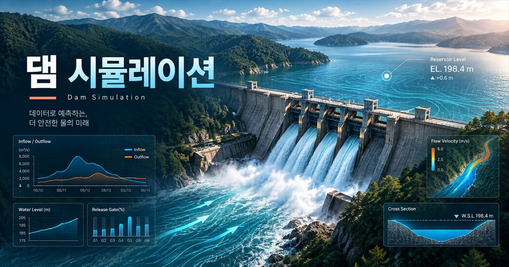

# 🌊 물길 (Mul-gil) · 댐 수문 실험실
> **DAM & RIVER OBSERVATORY**  
> *"저수지에서 마을까지, 하나의 흐름으로 연결된 수리(Hydraulic) 탐구"*

[](https://poeticecho.github.io/dam/)
[](https://threejs.org/)
[](https://www.khronos.org/webgl/)
[](LICENSE)

<br/>

<p align="center">
  
</p>

<p align="center">
  👉 <strong><a href="https://poeticecho.github.io/dam/">https://poeticecho.github.io/dam/ 에서 실시간 시뮬레이션 체험하기</a></strong>
</p>

---

## 📖 프로젝트 소개

**물길(Mul-gil)**은 댐 저수지의 수위 관리부터 5개 방류 수문의 개폐, 수력발전, 그리고 하류 하천의 제방 월류와 마을 침수에 이르는 **유역 전주기 수리 역학**을 웹 브라우저에서 3D로 직접 조작하고 관측할 수 있는 **인터랙티브 웹 시뮬레이터**입니다.

기존의 복잡한 수치해석 소프트웨어 없이도 누구나 직관적으로 수문을 열고 닫으며, 물의 높이 에너지와 유량, 지연 시간, 침수 확산의 원리를 직접 체감할 수 있도록 설계되었습니다.

---

## ✨ 핵심 기능 (Key Features)

### 1. 🎛️ 5개 여수로 수문과 정밀 수리 모델
* **실시간 물리 속도 반영**: 슬라이더로 목표 개방률(0~100%)을 지정하면 수문 권양기가 실제 속도에 맞추어 서서히 회전하며 문짝을 승·하강시킵니다.
* **오리피스 & 자유 월류 복합 수식**:
  $$\text{Orifice Flow: } Q = C_d \cdot b \cdot a \cdot \sqrt{2gH}$$
  $$\text{Free Weir Flow: } Q = C_w \cdot b \cdot H^{1.5}$$
  두 공식 중 수위에 맞는 유효 유량을 계산하여 수문턱(EL.97.2m) 이하에서는 방류가 자연 차단되고, 극한 만수위(EL.103m) 초과 시 비수문 구간의 댐체 월류가 연동됩니다.

### 2. ⚡ 수력발전소 가동 및 내부 투시
* **에너지 변환 경로 시각화**: 저수지(위치 에너지) $\rightarrow$ 압력 수압관(유속) $\rightarrow$ 프란시스 수차(회전) $\rightarrow$ 발전기(전기 에너지)로 이어지는 흐름을 내부 투시 뷰(Cutaway)로 관찰할 수 있습니다.
* **출력 계산**: $P = \rho \cdot g \cdot Q \cdot H \cdot \eta$ 공식에 따른 실시간 발전량(MW) 산출 및 별도 수로를 통한 하류 방류를 지원합니다.

### 3. 🌊 하류 하천 전달 지연 & 확산형 침수 알고리즘
* **하천 저류 추적**: 댐에서 방류된 물이 즉시 마을에 닿지 않고 유하시간(Lag Time)을 두고 수위를 상승시키는 물리적 지연을 표현합니다.
* **제방 월류 및 마을 침수**: 하류 수위가 제방고(4.2m)를 넘어서면 고저차가 반영된 지형 격자망을 따라 물이 퍼져나가며, 도로 차단 및 12채의 가구별 침수심을 실시간 계측합니다.

### 4. 🎓 4단계 인터랙티브 교육 여정 (Educational Journey)
| 단계 | 학습 주제 | 인터랙티브 실험 내용 |
| :---: | :--- | :--- |
| **01** | **댐의 역할** | 저수 공간 확보와 하류 안전 사이의 수위 조절 딜레마 관찰 |
| **02** | **수력발전 원리** | 물을 소모하지 않고 낙차와 유량으로 청정에너지를 만드는 과정 체험 |
| **03** | **조절 실패** | 만수위 상태에서 닥친 극한호우(45mm/h)로 인한 하류 범람 재난 시뮬레이션 |
| **04** | **우리의 대응** | **[사전 조절 + 조기 대피]** vs **[대응 지연]**의 하류 수위 변화 그래프 실시간 비교 |

### 5. 🎮 자유로운 관측 시점 및 환경 제어
* **3D 카메라 시점 프리셋**: 전체 유역 조망 / 댐 구조물 근접 / 하류 마을 시점 원클릭 전환
* **실시간 리더라인 라벨**: 3D 공간 좌표와 동기화된 구조물 명칭 안내 핀
* **조명 & 환경 모드**: 주간(Day) · 흐림 및 폭풍우(Storm) · 야간(Night) 조명 지원
* **시간 배속**: 정지(Pause)부터 최대 240배속까지 가상 시간 가속

---

## 🛠️ 기술 스택 (Tech Stack)

* **Core 3D Engine**: [Three.js](https://threejs.org/) (r160)
* **Graphics**: WebGL, 절차적 텍스처(Procedural Texture), 동적 물 표면 셰이더 & 포말 파티클
* **Architecture**: **Zero Dependency, No-Build Single HTML**
  * Node.js 빌드나 복잡한 패키지 설치 없이 `index.html` 단일 파일로 완전 독립 실행 가능
* **Hosting**: GitHub Pages

---

## 🚀 로컬 실행 방법 (Quick Start)

별도의 웹 서버나 설치 과정 없이 저장소를 복제한 뒤 브라우저로 열기만 하면 됩니다.

```bash
# 1. 저장소 클론
git clone https://github.com/PoeticEcho/dam.git

# 2. 디렉토리 이동
cd dam

# 3. 브라우저로 index.html 열기 (또는 더블클릭)
start index.html   # Windows
open index.html    # macOS
```

---

## 📚 수리 모델 및 학술적 참고 자료

* **USACE (미 육군 공병단)**: [HEC-RAS Hydraulic Reference Manual - Gated Spillways & Weirs](https://www.hec.usace.army.mil/confluence/rasdocs/ras1dtechref/latest/modeling-gated-spillways-weirs-and-drop-structures/hydraulic-computations-through-gated-spillways)
* **한국수자원공사 (K-water)**: 홍수 관리 체계 및 사전 방류 통보 프로세스
* **행정안전부**: [국민안전24 자연재난 호우 행동요령](https://safekorea.go.kr/)

> *본 프로젝트는 교육 및 시각적 이해를 돕기 위한 축약 수리 근사 모델이며, 실제 댐의 방재 운영 및 정밀 수치 예보용이 아닙니다.*

---

## 📄 라이선스 (License)

This project is licensed under the MIT License - see the [LICENSE](LICENSE) file for details.
